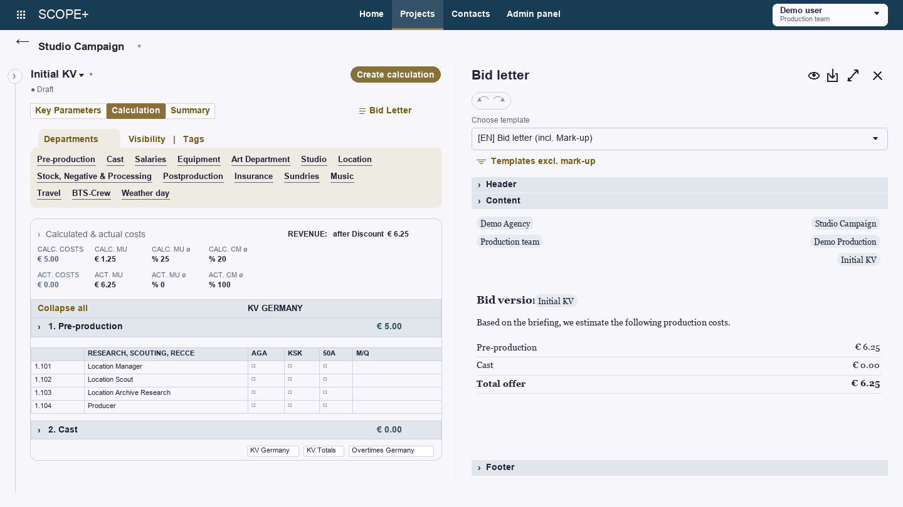
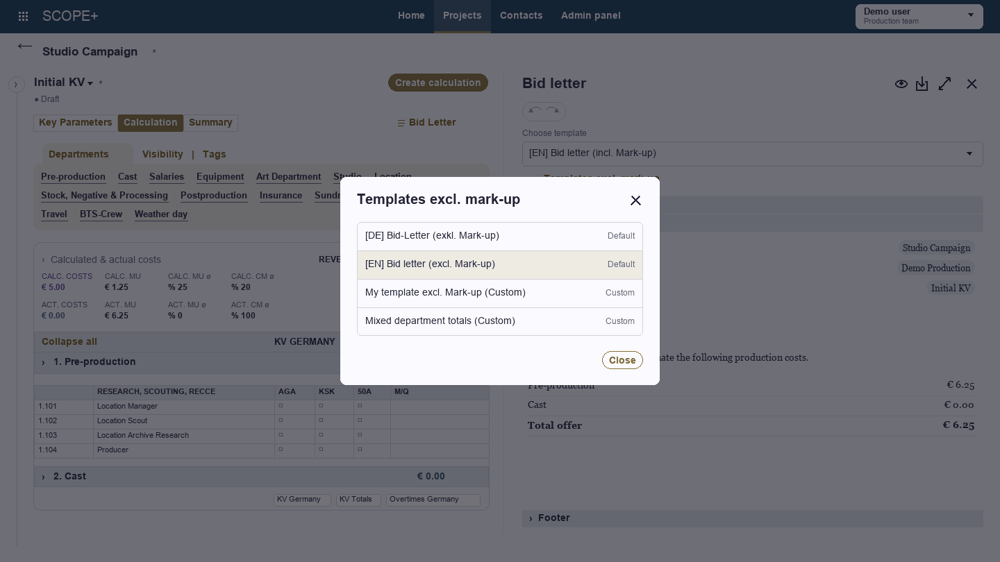
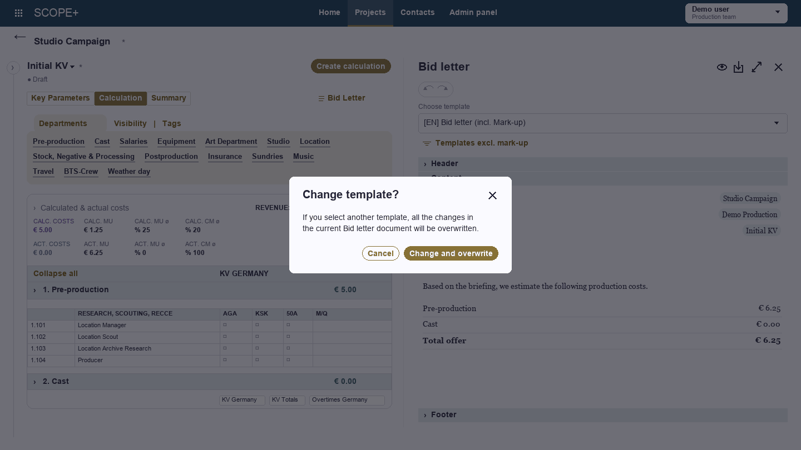
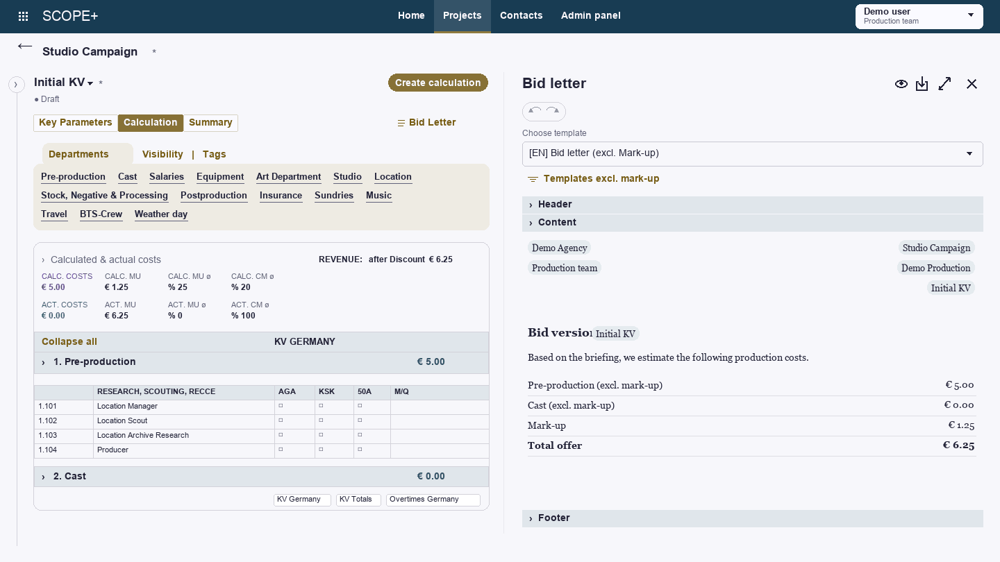
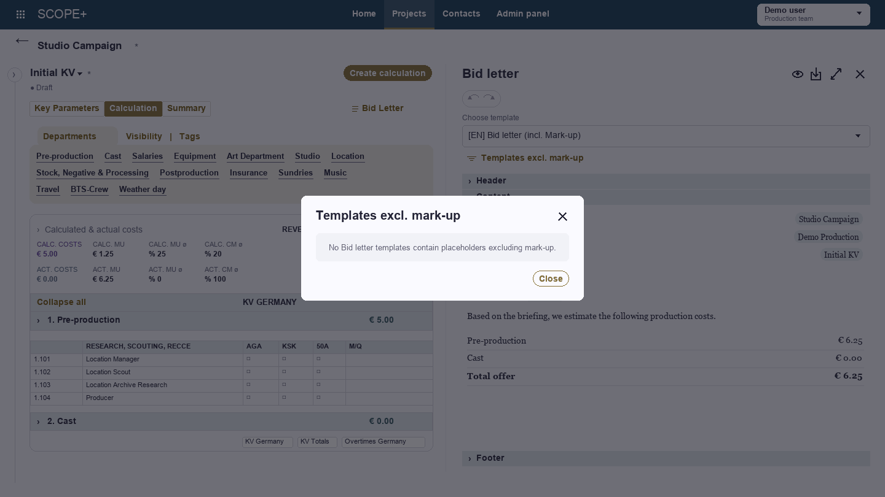
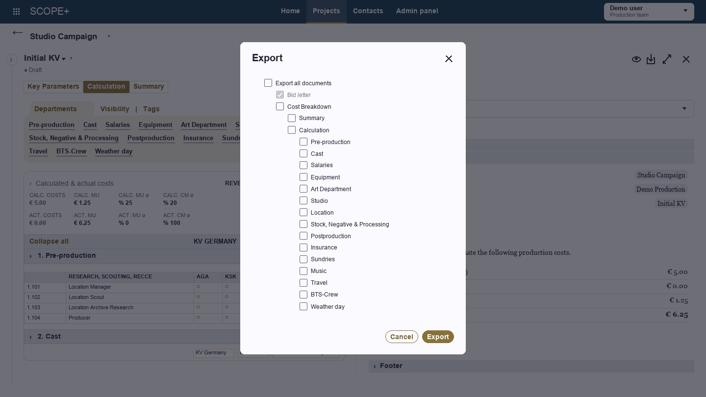
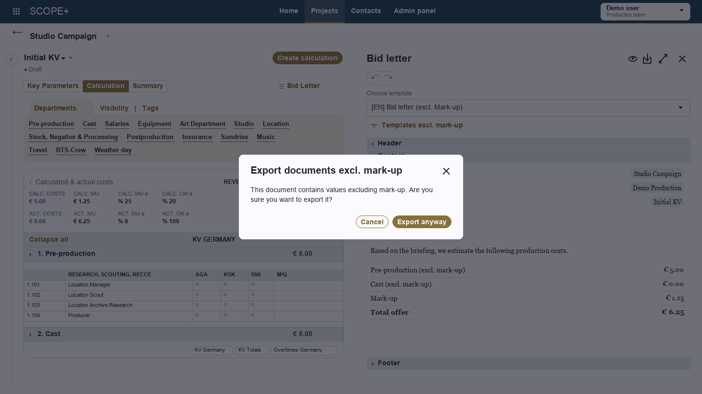
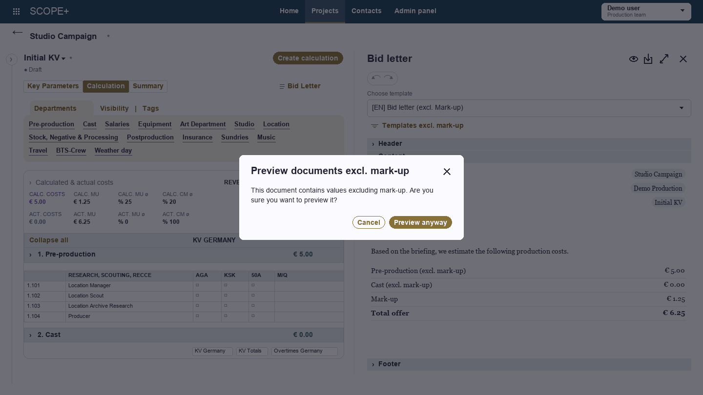
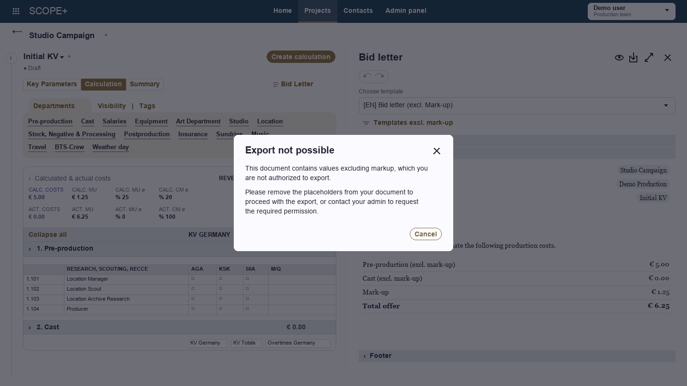

# ScopeX · Bid letter mockups

Static design mockups with demo data. Select any image to open it at full size.

## Select a template excluding mark-up

### Bid letter editor

The filtered template list opens from the editor.

### Templates excluding mark-up

Standard and custom templates appear together when they contain at least one excl. mark-up placeholder.

### Confirm template replacement

Changing the template overwrites the current letter. Cancelling keeps the current content.

### Template applied

The letter can show production costs excluding mark-up, with mark-up on a separate line.

### No matching templates

The list shows an empty state when no available template contains an excl. mark-up placeholder.

## Preview and export · AN142

### Export options

The Bid letter option is selected and locked.

### Confirm export

An authorized user confirms export of a letter with excl. mark-up values.

### Confirm preview

An authorized user confirms preview before the PDF opens in a new tab.

### Permission denied

The dialog explains why export is blocked and how to proceed.

